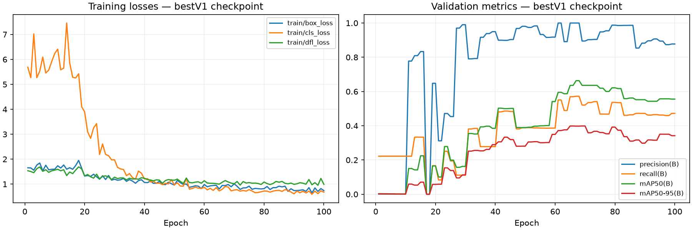

# 🍪 Cookie Clicker AI

Локальный бот для [Cookie Clicker Old в Яндекс Играх](https://yandex.ru/games/app/cookie-clicker-old-238578): непрерывные клики, покупка доступных зданий от дорогих к дешёвым и закрытие распознанных рекламных крестиков.


## Запуск

Нужны Windows и Python 3.10+. На новом компьютере:

```powershell
python -m venv .venv
.venv\Scripts\python.exe -m pip install -r requirements.txt
.venv\Scripts\python.exe app.py
```

При уже установленных зависимостях достаточно `python app.py` из папки проекта. Открой игру на основном мониторе, разверни браузер и выбери **«Купить / 1»** в магазине. После запуска есть три секунды для переключения в игру. Не закрывай её другими окнами во время работы.

**Пробел в любом окне завершает программу.** Также работают Ctrl+C в терминале и аварийная остановка при перемещении мыши в угол экрана. Если системная горячая клавиша недоступна, программа завершится до начала кликов.

Проверка без реальных кликов: `python app.py --dry-run --seconds 20`. Короткий запуск с автоматической остановкой: `python app.py --seconds 20`. Сохранённый кадр: `python app.py --image "C:\path\frame.png"`. Конфигурация по умолчанию лежит рядом с приложением; запуск из другой папки поддерживается.

## Непрерывный режим

Мышью управляет отдельный поток. ONNX и OCR работают в фоне, поэтому обработка магазина не создаёт пауз между сериями кликов. Быстрая проверка текстуры печеньки обновляет цель на каждом снимке; ONNX помогает при пропусках и ищет магазин. Его игровая цель дополнительно проверяется по цвету и текстуре.

Типовые круглые серые кнопки с белым X ищутся перед нейросетью и OCR. При рекламе клики по печеньке приостанавливаются. Закрытие рекламы и покупка используют общий замок мыши: поток печеньки не перенесёт курсор во время другого действия. Возобновление разрешает новый кадр.

Доступные цены определяются по зелёному тексту и OCR с кириллицей. Среди уверенно прочитанных видимых цен выбирается максимальная. После покупки программа ждёт обновления и читает новый кадр. Старую цену запрещено повторно использовать после покупки; изменение её участка изображения отменяет отложенное действие. Пока OCR работает, печенька продолжает кликаться, поэтому баланс может увеличиваться. Покупки продолжаются при наличии распознанных доступных товаров. Остаток меньше минимальной цены потратить невозможно.

При пропаже свежих кадров цель автоматически истекает. Каждые две секунды журнал показывает `STATUS`, фактические клики/с, суммарные действия и время обработки. `NO COOKIE` означает отсутствие подтверждённой цели; `advertisement` — приоритет закрытия рекламы. Строка запуска `Continuous clicker v2` показывает точные пути приложения и конфигурации.

## Настройки

Изменения в [config.json](config.json) применяются после перезапуска.

| Параметр | По умолчанию | Назначение |
|---|---|---|
| `clicks_per_second` | 250 | Желаемая частота кликов; реальная скорость зависит от ПК и игры |
| `target_ttl` | 0.50 с | Срок цели без нового подтверждающего кадра |
| `analysis_interval` | 0.25 с | Минимальный промежуток отправки кадров на ONNX/OCR |
| `loop_interval` | 0.005 с | Пауза захвата и быстрой проверки экрана |
| `confidence` | game 0.80, upgrade 0.25, advertising 0.80 | Пороги ONNX; текстурная проверка печеньки работает отдельно |
| `cooldowns` | game 0, close_ad 0.50, upgrade 0.15 с | Минимальные промежутки соответствующих действий |
| `ad_auto_close` | true | Визуальный поиск круглого серого крестика |
| `ad_settle_seconds` | 0.30 с | Ожидание обновления после закрытия рекламы |
| `max_inference_age` | 1.5 с | Максимальная давность фонового результата |
| `region` | null | `[left, top, width, height]` основного экрана |
| `startup_delay` | 3 с | Отсчёт перед началом |
| `shopping.enabled` | true | Автоматические покупки |
| `shopping.ocr_confidence` | 0.80 | Минимальная уверенность чтения цены |
| `shopping.settle_seconds` | 0.12 с | Ожидание после покупки |
| `shopping.region` | null | Область магазина внутри захватываемого кадра; null — поиск по ONNX |
| `shopping.price_column` | [0.15, 0.72] | Полоса цен как доля ширины магазина |
| `shopping.bottom_fraction` | 0.90 | Нижняя граница автоматического чтения |
| `shopping.failed_retry_seconds` | 1.5 с | Отсрочка повторной попытки при неизменной цене |

Покупаются видимые здания. Скрытые строки не прокручиваются, верхние иконки отдельных улучшений автоматически не покупаются. Неизвестные цены пропускаются. Крестики другого оформления могут не распознаться. При смене окна, масштаба или модели сначала проверь `--dry-run`. Экраны реальных платежей и восхождения не поддерживаются.

## Модель

Включена пользовательская `bestV1.pt` под именем `runs/detect/cookie_detector/weights/best.pt` и её FP32 ONNX-экспорт. Вход `[1, 3, 640, 640]`, выход `[1, 7, 8400]`, opset 12. ONNX Runtime запускает игровую модель и OCR; OpenCV обрабатывает изображения. Для работы не нужны PyTorch и Ultralytics.

| ID | Класс | Объект |
|---|---|---|
| 0 | game | Основная печенька |
| 1 | upgrade | Здание в магазине |
| 2 | advertising | Кнопка закрытия рекламы |

Класса бонусов нет. Метрики исходного checkpoint: Precision **0.895**, Recall **0.521**, mAP50 **0.636**, mAP50–95 **0.399**. Конвертация не улучшает точность модели.



В `runs/` оставлен один выбранный результат: веса, экспорт, параметры и восстановленные из checkpoint метрики. Старый локальный датасет с четырьмя классами напрямую не подходит этой модели. Данные не входят в репозиторий.

## Проверки

Прошли 26 автоматических проверок: приоритеты, цены, расходование 10 000 с ростом цен, остановка, свежесть кадров, исключение одновременных действий мыши, непрерывные клики при зависшем распознавании, отключение мыши в dry-run. Это проверки логики с заменённой мышью, а не измерение живой игры.

На 51 старом размеченном кадре быстрый поиск нашёл 37 из 43 обычных игровых кадров: все центры попали в размеченную печеньку. С подтверждёнными ONNX-целями найдены 40 из 43; на восьми рекламных кадрах ложных игровых центров нет. На отдельных сохранённых кадрах 713×615 и 1920×1080 текстурный поиск нашёл печеньку. Это ограниченный набор, не гарантия распознавания любых окон и реклам.

Предыдущая проверка экспорта против PyTorch: 49 совпавших обнаружений на 51 кадре при прежних порогах, разница уверенности до 0.00000060, IoU от 0.9964. После перехода на непрерывный режим живая проверка пока не завершена: инструмент управления Edge остановился из-за невозможности определить URL. Значение 250 кликов/с — настройка, не подтверждённая скорость в игре.

## Обучение

```powershell
python -m pip install -r requirements-training.txt
python screener.py
python auto_label.py
# Проверь разметку вручную.
python convert.py . screenshots
python train.py
python export_onnx.py
```

Нужны собственные локальные данные с классами из `class.txt`.

```text
app.py                       # ONNX, непрерывная мышь, фоновые цены
vision.py                    # Текстура печеньки, крестики и OCR
config.json                  # Частота, уверенность, кулдауны
assets/                      # OCR и маленький шаблон печеньки
requirements.txt             # Зависимости запуска
requirements-training.txt    # Дополнительно для обучения
screener.py / auto_label.py   # Сбор и предварительная разметка
convert.py / train.py         # Подготовка данных и обучение
export_onnx.py                # Экспорт весов
runs/detect/cookie_detector/  # Единственный выбранный результат
```

`.gitignore` разрешает только публичные исходники и выбранные артефакты. Датасеты, виртуальные окружения, кэши и остальные запуски остаются локальными.
